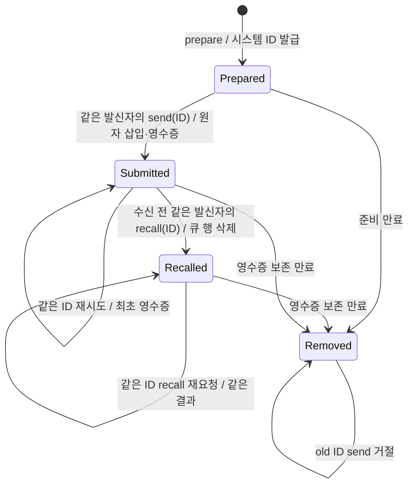

[English](session-messaging.md)

# 세션 메시지 계약

세션 메시지의 ID 발급, 재시도, 회수, ACK, 깨우기, autoWake와 peer 결과 대기 판정의 계약을 정리한다. 사용자용 설명은 [세션 협업](../user/collaboration.ko.md)에 있다.

**읽는 법:** 메시지 연산은 상주 서버(`SessionMessageService`는 서버 어댑터, 큐 자체는 `sennard-app`의 `MessagingService`) 안에서 실행하고 연산 하나는 데이터베이스 transaction 하나다. 연산은 데이터베이스의 기본 격리 수준에서 실행하고, 경쟁에서 진 연산은 다시 실행하지 않는다. 경쟁의 승패는 조건부 `UPDATE`가 정한다. 두 claimer가 같은 메시지를 가져가려 하면 문장이 행을 바꾼 쪽(`WHERE`가 요구하는 「아직 claim 가능」, 곧 확인 전·만료 전·유효한 임대 없음을 만족한 쪽)이 메시지를 받고, 다른 쪽은 행을 바꾸지 못하므로 그 메시지에서 아무것도 가져가지 않고 받은 것이 없다고 답한다. 훅의 claim과 source receipt는 한 transaction이고 잠금을 잡지 않는다. receipt에 서명하는 키는 서버가 시작할 때 한 번 만들고, claim은 읽기만 한다. 큐 전체의 한도는 쓰기 전에 읽어 판단하므로 동시에 보내면 몇 건 넘을 수 있고, 세션 하나의 한도는 조건부 `UPDATE`라서 정확하다. 잠금 함수·명시적 행 잠금·advisory lock은 쓰지 않는다. 아래 절에서 「broker」는 그 연산을 실행하는 서버로 읽는다.

- Claude Code는 대기 hook(`WakeController`, `WakeWaiters`)을 사용한다. 공용 native 경로(`IdleWakeService`)에는 Codex queue adapter와 Antigravity agentapi adapter가 있다. 검증한 marker만 일반 입력 소비자보다 앞선 경계에서 본문을 인수한다. Codex의 native wake는 기본으로 꺼져 있다. Antigravity는 프로젝트 ID 등 대상 훅이 제공한 연결값을 사용한다. 훅이 제공한 대화 ID는 대상 대화와 일치해야 한다. 격리 시험에는 합성 입력을 사용했으며 실제 Antigravity 세션의 연결값 제공과 전달은 아직 미검증이다. [native wake 상세](native-idle-wake.ko.md)를 본다.
- `autoWake`는 대기 hook이나 native 경로의 준비 상태를 보고한다. 비활성, 사전 조건 누락, 작업 중인 수신자, 미관측 알림을 구분하며 전달이나 ACK는 보고하지 않는다. `status.wake`는 계속 `null`이다.
- 서버가 모르는 대상의 `prepare_session_message`는 큐에 넣지 않고 `NOT_FOUND`(`details.reasonCode=SESSION_NOT_FOUND`)로 거절한다. 본문 길이·NUL·TTL 범위 위반은 `INVALID_INPUT`이고 `details.reasonCode`가 위반한 규칙(`MESSAGE_BODY_SIZE`, `MESSAGE_BODY_NUL`, `MESSAGE_TTL_RANGE`)이다.

## 메시지 ID와 재시도

새 메시지는 `prepare_session_message`로 준비하고 반환된 `messageId`만 `send_session_message`에 전달한다. 준비는 발신자·대상·본문·TTL을 고정하며 수신 큐·peer 관계·깨우기에 영향을 주지 않는다. ID는 서버가 발급해 저장소에 보존한다. caller가 ID를 만들거나 전송 때 내용을 바꿀 수 없다.



`schemaVersion: "1.0.0"`, `targetHost`, `targetSessionId`, `body`, 선택 항목 `ttlSeconds`로 `prepare_session_message`를 호출한다. `targetActorId`를 생략하면 루트가 수신자다. 자식에게 보내려면 관측된 자식 actor ID를 `targetActorId`에, 루트 세션 ID를 `targetSessionId`에 넣는다. 반환된 `messageId`로 `send_session_message`를 호출한다. 서버는 관측된 호출자를 발신자로 결속한다. 자식은 루트 세션 안에서 별도 주소를 갖는다. 자식이 수신자인 메시지의 상태 응답에는 수신자의 `actorId`가 포함된다. peer 봉투에는 자식 발신자와 자식 수신자 각각의 `actorId`가 포함된다.

prepare에서 발신자와 수신자 주소가 확정된다. 발송·상태 조회·회수에는 저장된 주소를 사용하며, 지정된 수신자만 본문을 인수하고 영수증으로 수신을 확인할 수 있다. 루트나 형제는 자식의 영수증을 확인할 수 없다. 쓰기 요청의 작업 키는 호출자의 peer 주소별로 적용된다. 발급되지 않은 ID, 다른 발신자, send 요청에 추가된 본문·대상·TTL은 큐에 기록하기 전에 거부한다.

prepare 응답의 `expiresAt`은 보내지 않은 draft가 만료되는 시각입니다(`ttlSeconds`와 상관없이 `preparedAt`으로부터 10분). `ttlSeconds`는 첫 send부터 세고, send 응답의 `expiresAt`이 메시지 자체의 만료(send 시각에 TTL을 더한 값)입니다.

prepare 응답이 유실되어 다시 준비하면 사용하지 않는 draft가 남을 수 있지만 전달은 일어나지 않는다. send 응답이 유실되면 이미 알고 있는 같은 발급 ID로 `get_session_message_status`를 조회하거나 send를 재시도한다. 최초 큐 삽입과 제출 상태·영수증 저장은 같은 transaction으로 확정한다. 서버 재시작이나 다른 연결의 동시 send에도 같은 ID로 다시 삽입하거나 expiry를 늘리지 않는다.

**unknown ID는 전송이 없었다는 증거가 아니다.** 이미 전송한 기록이 정리됐을 수 있으므로 보관한 영수증과 대조한다. 불명확한 전송을 무조건 새 prepare로 다시 보내지 않는다. 새 prepare는 새 전송 의도에 사용한다. 수신 모델의 업무를 exactly-once로 실행한다는 보장은 없다.

| 저장 대상 | 경계 |
| --- | --- |
| 미전송 draft | prepare부터 10분; sender별 100개, 전역 1000개 |
| 제출 영수증 | 전역 1000개, sender별 250개; 미ACK 메시지는 최초 메시지 expiry 이후 1시간, ACK된 메시지는 `min(메시지 expiry+1시간, 최초 ACK+1시간)`까지 보존 |
| draft·영수증 전체 | record byte 합 최대 4 MiB(record 하나는 행의 고정 몫 160 byte에 ID·두 세션 참조·본문의 UTF-8 byte를 더한 값이고, 영수증은 본문이 없다); 전송 뒤 본문 중복 저장 제거 |
| 실제 수신 큐 | 기존 미ACK 메시지 최대 1000개·본문 합 4 MiB |
| 메시지 TTL | 첫 send부터 30~86400초, 기본 3600초 |

상한에서는 명시적으로 거절하며 미만료 기록을 강제로 지우지 않는다. 영수증이 정리된 ID도 unknown으로 거절해 새 메시지가 생기지 않는다.

sender별 영수증 상한은 협력하는 세션 사이의 공정성 장치다. sender는 host hook이 결속한 세션 식별자일 뿐 인증된 principal이 아니므로, 같은 OS 사용자의 의도적 우회를 막는 할당량으로 보지 않는다. send는 같은 transaction에서 정리 뒤 sender 상한, 전역 상한 순으로 검사하는 권위 검사다. prepare도 같은 방식으로 영수증 용량을 먼저 확인해 이미 상한에 닿았으면 draft를 만들지 않고 `no draft was created`로 거절한다. 이 prepare 검사는 입장 확인일 뿐이며, prepare와 send 사이에 용량이 차면 send가 거절하고 해당 draft는 준비 만료까지 남는다.

영수증 용량 거절은 효과가 없었음이 확정된 거절이다. 메시지는 큐에 들어가지 않았고 영수증도 발급되지 않았다. 도구 응답의 `error.code`는 `MCP_UNAVAILABLE`이고, `error.details`에 `reasonCode`(거절한 한도: `MESSAGE_PREPARATION_FULL` 등), `scope`(`sender` 또는 `global`)와 해당 범위에서 가장 먼저 만료되는 기록의 시각 `earliestReleaseAt`을 담는다. send가 큐의 규칙으로 거절되면(예: 발급되지 않은 ID) `MCP_UNAVAILABLE`, `details.reasonCode=SEND_REJECTED`이고 `error.params.reason`이 거절 사유 문장이다. 그 시각 뒤에는 새 prepare가 성공할 수 있지만 다른 sender가 먼저 용량을 쓸 수 있으므로 보장은 아니다. send에서 거절된 `messageId`는 prepare 응답의 `expiresAt`(준비 만료)까지 `PREPARED`로 남는다. `earliestReleaseAt`이 그 `expiresAt`보다 이르면 그 시각 뒤 같은 `messageId`로 재시도할 수 있다. 그렇지 않으면 draft가 먼저 만료되므로 새로 prepare한다. 둘 다 하지 않는다. 둘 다 하면 한 의도가 두 메시지로 전달될 수 있다. 용량 거절을 받은 뒤 그 ID로 다시 send하지 않았는데 draft가 만료돼 같은 ID의 send가 unknown(`Issued message ID is unavailable`)으로 거절될 수 있다. 이 경우 그 ID는 앞선 확정 거절로 전달되지 않았음이 이미 확인됐으므로, 저장한 거절 응답과 대조한 뒤 새로 prepare해도 된다. 확정 거절 기록이 없는 unknown ID는 저장한 영수증과 대조하고 무조건 다시 준비하지 않는다. 응답을 받지 못한 불확실한 send는 이 경우가 아니며, 같은 ID로 status를 조회하거나 send를 재시도한다.

ACK는 해당 수신 대상에 대해 서버에 claim 이력이 기록되고 원 인수 영수증이 일치하는 메시지만 처리한다. 인수 응답의 본문과 `claimReceipt`를 같은 처리 문맥에 보존하고, 처리한 `messageIds`에 대응하는 `receipts: [{messageId, claimReceipt}]`를 반환한다. 최신 영수증을 조회하거나 메시지 ID 캐시에서 자동 선택해 붙이지 않는다. 아직 인수하지 않은 메시지, 다른 수신 대상, 모르는 ID, 영수증 누락·불일치는 메시지 상태·제출 영수증 만료·세션 활동 시각을 바꾸지 않는다. 인수 이력은 전달 대상으로 선택했다는 기록이며 실제 소비·업무 완료·권한의 증거는 아니다. 임대만 만료되고 재인수가 없으면 원 영수증의 늦은 ACK는 성공한다. 다른 회차가 재인수하면 이전 영수증은 효력을 잃고 새 회차를 확정할 수 없다.

ACK는 처음 성공한 ACK에서만 영수증 만료를 줄인다. 두 번째 ACK, 대상이 아닌 세션의 ACK, 모르는 ID의 ACK는 만료를 바꾸지 않으며, 줄인 만료는 다시 늘지 않는다. 따라서 ACK 후 1시간이 지난 ID는 status가 unknown(`null`)이고 같은 ID의 send도 발급 ID 없음으로 거절한다. 영구 tombstone이나 별도 DB·daemon은 없다. status는 준비 상태, queued/delivered/acknowledged 상태 또는 큐 행이 정리된 뒤 제출 영수증과 `deliveryState: "unknown"`을 구별한다.

ACK 전 lease 재전달은 정상이며 같은 ID·본문을 유지한다. 중복 ACK는 최초 ACK 시각을 늘리지 않는다. ACK는 처리 확인으로, 업무 완료나 승인이 아니다.

## 회수

발신자는 수신자가 아직 받지 않은 자기 메시지를 `recall_session_message`(`schemaVersion`, `operationKey`, `messageId`)로 회수할 수 있다. 호스트와 관계없이 같은 MCP 도구를 사용한다.

큐의 쓰기 도구는 모두 호출자가 만든 `operationKey`를 필수로 받는다. 동일한 발신 주소에서 같은 키와 내용으로 호출하면 저장된 결과가 반환된다. 같은 발신 주소와 키에 다른 내용을 보내면 `REQUEST_CONFLICT`(`OPERATION_CONFLICT`)가 반환된다. 저장된 send 응답을 반환하는 경우에는 깨우기 상태를 건드리지 않는다.

- **받지 않음**: 아직 어떤 claim(MCP claim, 도구 경계, 턴 끝, 깨우기 도착)도 가져가지 않은 큐 행(`claimed_at`이 비어 있음)이다. 회수는 한 transaction에서 이 조건으로 큐 행을 지우고 제출 영수증에 `recalledAt`을 적는다. claim도 같은 transaction 규칙으로 행을 다시 읽으므로 회수와 claim이 겹치면 먼저 확정한 쪽 하나만 이긴다. 회수된 메시지는 대기 수와 깨우기 후보에서 빠지며 수신자에게 영영 전달되지 않는다.
- **이미 울린 깨우기**: 깨우기 신호가 이미 나간 뒤 claim 전에 회수하면 그 깨우기는 메시지 0건으로 끝난다. 이는 빈 깨우기 경로(`peer.wake.noMessage`)이며 hook 실패로 보고하지 않는다.
- **응답**: 성공하면 `recalled: true`와 `status`(`state: "RECALLED"`, `recalledAt`, `receiptExpiresAt`)를 돌려준다. 같은 요청을 다시 보내면 같은 `recalledAt`과 `duplicate: true`를 돌려주고 아무것도 바꾸지 않는다. 회수할 수 없으면 `recalled: false`와 `reason`을 돌려주며 아무것도 쓰지 않는다. `DELIVERED`는 수신자가 이미 받았다는 뜻이고 `status`에 `claimedAt`·`firstDeliveredAt`·`acknowledgedAt`이 있다. `EXPIRED`는 메시지 TTL이 지났다는 뜻이다. `NOT_SENT`는 준비만 하고 보내지 않은 ID다. `UNKNOWN`은 `status: null`이며 다른 발신자의 메시지와 모르는 ID를 구별하지 않는다(`get_session_message_status`와 같은 관례).
- **보존**: 회수된 메시지의 제출 영수증은 ACK와 같이 `min(기존 보존 기한, 회수 시각+1시간)`까지 남고, 그동안 `get_session_message_status`는 `RECALLED`를 보여 준다. 같은 ID의 send는 큐에 다시 넣지 않고 기존 영수증(`recalledAt` 포함)을 `duplicate: true`로 돌려준다. 영수증 상한·바이트 합 계산은 다른 영수증과 같다.

## 회차 영수증

새 인수마다 같은 transaction에서 `claimReceipt`를 발급하고 본문과 함께 반환한다. 이 값은 `<deliveryAttempt>:<무작위 UUID>`이며 모델이 만들거나 수정할 값이 아니다. 훅 봉투의 `receipt.claimReceipt`가 원값이다. 공개 수신 확인 도구는 다음 형식으로 원값을 전달한다.

```json
{"messageIds":["<원 messageId>"],"receipts":[{"messageId":"<같은 messageId>","claimReceipt":"<같은 인수 응답의 claimReceipt>"}]}
```

한 인수 응답의 전체 직렬화 크기는 UTF-8 32,768바이트 이하다. 본문뿐 아니라 영수증을 포함한 응답 봉투 전체를 계산한다. 요청의 최대 메시지 수는 상한이며 그 수를 한 번에 전달한다는 보장은 아니다. 바이트 상한 때문에 다음 메시지를 넣을 수 없으면 앞에서부터 담은 메시지만 인수하고 나머지는 큐에 남긴다. 소비자는 받은 묶음을 원영수증으로 확인한 뒤 다음 묶음을 인수하며, 전체 본문을 하나의 응답에 넣으려고 상한을 늘리거나 본문을 자르지 않는다. 메시지별 순서와 무손실 여부, 한글의 수신 조각 경계 처리는 이 배치 크기와 별도로 검증한다.

데이터베이스 제약은 영수증 없는 새 회차 인수와 새 회차 확정을 거부한다. 운영 데이터 삭제·교체·수동 열 수정으로 우회하지 않는다. 원 호스트 호출 증명의 도구명·인자 지문·호출 ID·유효기간·서명·일회 소비 검사는 영수증으로 대신하지 않는다.

## hook 없는 호스트

hook이 없는 호스트는 MCP 도구로 보낸다. `prepare_session_message`로 준비하고, 응답의 `messageId`를 보관해 `send_session_message`에 그대로 넘긴다. send에 body/target/TTL이나 임의 ID를 넣으면 오류로 거부되며 전달 효과가 없다. 본문과 비밀은 프로세스 인수에 넣지 않는다.

훅 없이 서버가 발급한 세션 참조를 명시하면 루트 주소를 사용한다. 자식 주소로 호출하려면 호스트 관측이 필요하다. 격리 시험에서 Codex, Claude Code, Antigravity의 지원 훅 경계를 통한 자식 전달을 확인했다. 호스트 내부의 에이전트 입력까지 통제하려면 호스트의 지원이 필요하다. 예를 들어 Codex의 입력 분배기는 `UserInput`에 `UserPromptSubmit`을 적용하며 `InterAgentCommunication`은 별도 경로로 처리한다. Claude Code는 백그라운드 알림도 프롬프트 제출로 보고할 수 있으므로 해당 이벤트만으로 사람이 직접 입력했는지 판별할 수 없다. [Codex 입력 분배기 소스](https://github.com/openai/codex/blob/main/codex-rs/core/src/hook_runtime.rs)와 [Sennard 6.0.0 릴리스 노트](../release-notes/release-notes-v6.0.0.md)를 참고한다.

## 쉬는 세션 깨우기

깨우기는 「받은함을 보라」는 신호일 뿐이며 본문 권한의 경계가 아니다. 두 native adapter는 세션·세대에 결속된 공용 nonce와 source receipt의 같은 claim transaction을 사용한다. 예약된 marker 문법 안의 미발급·퇴역 nonce는 일반 사용자 입력이 되지 않는다. [native wake 상세](native-idle-wake.ko.md)를 본다.

- 대기 hook은 서버가 붙들고 있다가 그 세션을 대상으로 하는 메시지가 커밋되면 같은 요청에서 claim하여 돌려준다. 세션이 새 사용자 입력을 받으면 붙든 hook을 끝낸다(`WakeWaiters.release`).
- `wake_paths`에는 (session, instance, birth generation)마다 마지막 본문 claim 경계 시각(`claim_boundary_at`)만 둔다. `input_observations`는 도구 경계의 지연 claim을 한 번만 건너뛰기 위한 표시다.
- `native_wake_reservations`에는 native 시도 상태·nonce·세대·재시도 시각을 기록하고 연결 환경은 저장하지 않는다. 이 내부 상태는 본문 전달과 별개이며 메시지 status의 `wake`는 계속 `null`이다.

## 자동 깨우기 신호(autoWake)

`send_session_message`의 결과와 `get_session_message_status`의 미ACK 큐 행에는 조언용 `autoWake`가 붙는다. 계약은 `contracts/session-auto-wake-outlook.v2.schema.json`이며 `authorityEffect: "none"`이다. 발신 성공은 서버가 큐에 넣었다는 뜻이고, `autoWake`는 수신자의 idle 깨우기 경로를 지금 쓸 수 있는지에 대한 사실만 보고한다. 예측하지 않는다. 전달, 처리, 완료, 승인이나 권한의 증거가 아니고, 큐의 메시지를 지우거나 다시 보내지 않는다.

서버는 native 경로의 준비 상태도 보고한다. 꺼져 있으면 `unsupported`, 사전 조건 누락·작업 중인 수신자·미관측 알림·재시도 유예는 `degraded`, 소유한 live 연결이 없으면 `no-live-relay`다. 사용할 깨우기 경로가 없으면 본문은 일반 claim 경계까지 큐에 남는다. 확인된 전달과 깨우기 준비 상태는 구별해 알린다.

현재 자식 대상 메시지는 `no-live-relay`로 표시된다. 회수되거나 만료되기 전까지는 지정된 자식이 다음 지원 훅 경계에서 인수할 수 있다.

## 데이터베이스 이전과 복구

마이그레이션 V25는 peer 메시지 큐와 제출 영수증에 actor 열을 추가한다. 기존 행에는 루트 주소가 설정된다. V25 이전 바이너리는 actor 열을 해석할 수 없어 자식 행을 루트 행으로 처리할 수 있다. 이전 바이너리로 복구할 때는 V25 적용 전 데이터베이스 백업을 함께 사용한다. 이미 자식 메시지가 들어간 V25 데이터베이스는 별도로 보존하고, 해당 메시지는 V25와 호환되는 바이너리로 복구한다.

## peer 결과 대기 판정

메시지나 ACK는 업무 완료나 승인을 뜻하지 않는다. Codex의 `mcp__codex_app__wait_threads` 호출 전에는 제한된 조회·대기 안내(`peer.wait.boundedGuidance`)를 돌려주며 호출을 거절하거나 반복 조회를 합치지 않는다. native 깨우기 복원에 긴 대기 정책을 추가하지 않았다. `get_session_message_status`, 일반 sleep·셀 대기·프로세스·테스트 대기는 이 안내의 대상이 아니다.

`wait_threads` 요청은 JSON 키 순서, `hostId` 생략과 `local`, target 배열 순서, 동일 target·cursor 중복을 같은 의미로 정규화한다. `afterCursor`는 생략 또는 문자열만 지원하며 형식이 다르면 안내 경로로 진입하지 않는다. 판정 근거에 본문·token을 새 로그에 기록하지 않는다. 같은 사용자 협업 모델의 신뢰 경계는 그대로이며, 공격적인 동일 사용자 process의 호출이나 파일 조작을 보안 격리로 막는 기능은 아니다.
