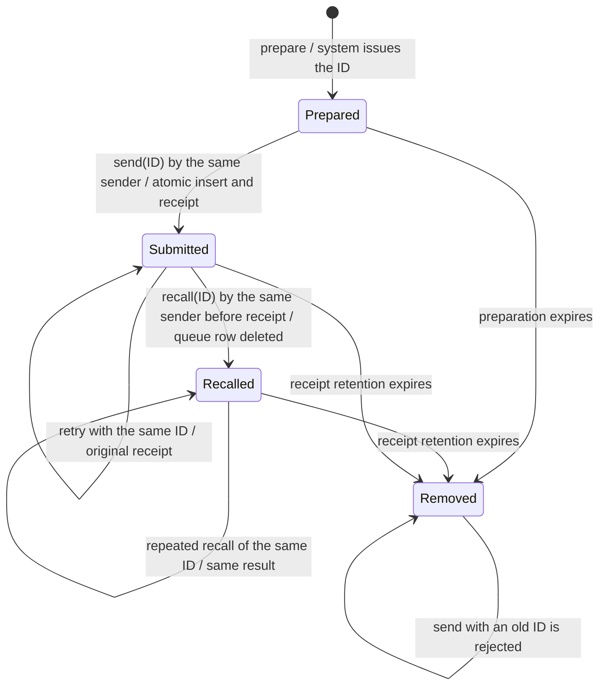

[한국어](session-messaging.ko.md)

# Session Message Contract

This document summarizes the contract for session message ID issuance, retries, recall, ACK, wake-up, autoWake, and the decision about waiting for a peer's result. The user-facing description is in [Session Collaboration](../user/collaboration.md).

**How to read this document:** Message operations run inside the resident server (`SessionMessageService` is the server adapter, and the queue itself is `MessagingService` in `sennard-app`), and one operation is one database transaction. Operations use the connection pool's isolation level. The personal edition sets `sennard.store.isolation` to `READ_COMMITTED` by default. With `DEFAULT`, the pool uses the database's default isolation level. An operation that loses a race is not run again. The winner of a race is told by a conditional `UPDATE`: when two claimers take the same message, the one whose statement changes the row (the `WHERE` asks that the message is still claimable: not acknowledged, not expired, no live lease) gets the message, and the other changes no row, takes nothing from that message, and answers that nothing was received. A hook's claim and its source receipt are one transaction and take no lock; the signing key of the receipts is created once when the server starts, and a claim only reads it. The limits over the whole queue are read before the write, so concurrent senders may pass them by a few messages; the limits of one session are conditional `UPDATE`s and are exact. Lock functions, explicit row locks, and advisory locks are not used. In the sections below, read "broker" as the server that runs those operations.

- Interactive Claude Code uses its waiting hook (`WakeController`, `WakeWaiters`). Codex uses its native queue by default, and Antigravity uses `agentapi` with the target hook’s project and connection values. Both use `IdleWakeService` and can register again at the next eligible `Stop` after a server restart. Only a verified marker claims the body before native-input consumers. See [native wake](native-idle-wake.md).
- `autoWake` reports the current wait hook or native path readiness, including disabled, missing prerequisites, active recipient and outstanding attempts. It never reports delivery or ACK. `status.wake` remains `null`.
- `prepare_session_message` for a target that the server does not know is rejected with `NOT_FOUND` (`details.reasonCode=SESSION_NOT_FOUND`) without being queued. A violation of the body length, NUL, or TTL range is `INVALID_INPUT`, and `details.reasonCode` is the violated rule (`MESSAGE_BODY_SIZE`, `MESSAGE_BODY_NUL`, `MESSAGE_TTL_RANGE`).

A Sennard PEER message requires a confirmed main session at each endpoint. A child cannot send or receive a Sennard PEER message. A parent and the child it started use the host’s own tools for communication inside the [session tree](architecture.md#session-unit).

Antigravity can use native messaging when host observations resolve both endpoints to the same [session tree](architecture.md#session-unit). A native route is unavailable when the installed host supplies insufficient binding evidence for either endpoint.

## Message IDs and Retries

A new message is prepared with `prepare_session_message`, and only the returned `messageId` is passed to `send_session_message`. Preparation fixes the sender, target, body, and TTL, and does not affect the receiving queue, the peer relationship, or wake-up. The server issues the ID and keeps it in the store. The caller cannot create an ID or change the content at send time.



Call `prepare_session_message` with `schemaVersion: "1.0.0"`, `targetHost`, `targetSessionId`, `body`, and optional `ttlSeconds`. Pass the returned `messageId` to `send_session_message`. The server resolves both addresses using the [Session Unit](architecture.md#session-unit). Supplying `targetActorId` is refused.

Prepare fixes both addresses. Send, status and recall checks use the stored addresses. Only the addressed recipient can claim the body and acknowledge its receipt. The caller’s session address scopes the write operation key. Send rejects an unissued ID, a different sender, or extra body, target or TTL fields before writing to the queue.

The `expiresAt` of the prepare response is when the unsent draft expires (10 minutes after `preparedAt`, whatever `ttlSeconds` says). `ttlSeconds` counts from the first send, and the `expiresAt` of the send response is the message's own expiry (the time of the send plus the TTL).

If the prepare response is lost and the message is prepared again, an unused draft may remain, but no delivery takes place. If the send response is lost, either query `get_session_message_status` with the same issued ID that is already known, or retry the send. The first queue insert and the storage of the submission state and receipt are committed in the same transaction. Even after a server restart or a concurrent send from another connection, the message is not inserted again with the same ID and the expiry is not extended.

**An unknown ID is not evidence that no send took place.** The record of a message that was already sent may have been cleaned up, so compare against the receipt that was kept. An unclear send is not unconditionally sent again with a new prepare. A new prepare is for a new intent to send. There is no guarantee that the work of the receiving model is executed exactly once.

| Stored item | Bound |
| --- | --- |
| Unsent draft | 10 minutes from prepare; 100 per sender, 1000 globally |
| Submission receipt | 1000 globally, 250 per sender; an un-ACKed message is kept for 1 hour after the original message expiry, and an ACKed message until `min(message expiry + 1 hour, first ACK + 1 hour)` |
| All drafts and receipts | At most 4 MiB in total record bytes (one record is the row's fixed share of 160 bytes plus the UTF-8 bytes of the ID, the two session references, and the body, and a receipt has no body); duplicate storage of the body after sending is removed |
| Actual receiving queue | At most 1000 existing un-ACKed messages and 4 MiB of bodies in total |
| Message TTL | 30 to 86400 seconds from the first send, default 3600 seconds |

At a limit, the request is explicitly rejected, and records that have not expired are not forcibly removed. An ID whose receipt was cleaned up is also rejected as unknown, so no new message is created.

The per-sender receipt limit is a fairness device among cooperating sessions. The sender is only a session identifier bound by the host hook and not an authenticated principal, so it is not regarded as a quota that prevents deliberate circumvention by the same OS user. Send is the authoritative check, which in the same transaction checks the sender limit and then the global limit after cleanup. Prepare checks the receipt capacity first in the same way, and if the limit has already been reached it creates no draft and rejects with `no draft was created`. This prepare check is only an admission check; if the capacity fills between prepare and send, send rejects and that draft remains until the preparation expires.

A rejection for receipt capacity is a rejection that is confirmed to have had no effect. The message did not enter the queue and no receipt was issued. The `error.code` of the tool response is `MCP_UNAVAILABLE`, and `error.details` carries `reasonCode` (the limit that rejected, such as `MESSAGE_PREPARATION_FULL`), `scope` (`sender` or `global`), and `earliestReleaseAt`, the time of the record that expires first in that scope. If send is rejected by a queue rule (for example, an ID that was not issued), it is `MCP_UNAVAILABLE` with `details.reasonCode=SEND_REJECTED`, and `error.params.reason` is the sentence giving the reason for the rejection. A new prepare may succeed after that time, but this is not guaranteed because another sender may use the capacity first. A `messageId` rejected at send remains `PREPARED` until the `expiresAt` (preparation expiry) of the prepare response. If `earliestReleaseAt` is earlier than that `expiresAt`, the send can be retried with the same `messageId` after that time. Otherwise the draft expires first, so prepare anew. Do not do both. Doing both can deliver one intent as two messages. After a capacity rejection, if the same ID is not sent again and the draft expires, a send with the same ID can be rejected as unknown (`Issued message ID is unavailable`). In that case it has already been confirmed that the ID was not delivered, because of the earlier confirmed rejection, so after comparing against the stored rejection response it is acceptable to prepare anew. An unknown ID with no record of a confirmed rejection is compared against the stored receipts and is not unconditionally prepared again. A send whose response was not received is uncertain and is not this case; query the status with the same ID or retry the send.

ACK handles only a message for which a claim history is recorded on the server for that receiving target and whose original claim receipt matches. The body of the claim response and the `claimReceipt` are kept in the same processing context, and the `receipts: [{messageId, claimReceipt}]` that correspond to the processed `messageIds` are returned. The latest receipt is not looked up or automatically selected from a message ID cache and attached. A message that has not yet been claimed, a different receiving target, an unknown ID, and a missing or mismatched receipt do not change the message state, the submission receipt expiry, or the session activity time. The claim history is a record that the message was selected as a delivery target and is not evidence of actual consumption, completion of work, or authority. If only the lease has expired and there is no re-claim, a late ACK with the original receipt succeeds. If another attempt re-claims, the earlier receipt loses its effect and the new attempt cannot be confirmed.

ACK shortens the receipt expiry only on the first successful ACK. A second ACK, an ACK from a session that is not the target, and an ACK for an unknown ID do not change the expiry, and a shortened expiry is not extended again. Therefore an ID 1 hour after its ACK has a status of unknown (`null`), and a send with the same ID is also rejected as having no issued ID. There is no permanent tombstone and no separate database or daemon. Status distinguishes the prepared state, the queued, delivered, or acknowledged state, or the submission receipt with `deliveryState: "unknown"` after the queue row has been cleaned up.

Redelivery under a lease before ACK is normal and keeps the same ID and body. A duplicate ACK does not extend the time of the first ACK. ACK is a confirmation of processing and is not completion of work or approval.

## Recall

A sender can recall its own message before the recipient receives it with `recall_session_message` (`schemaVersion`, `operationKey`, `messageId`). Each queue write tool requires an `operationKey`. The same caller address, key and content return the stored answer without repeating the operation. Different content under the same address and key returns `REQUEST_CONFLICT` (`OPERATION_CONFLICT`). A replay of a stored send response leaves the wake state alone.

- **Not received**: a queue row that no claim (MCP claim, tool boundary, supported Stop event, wake arrival) has taken yet (`claimed_at` is empty). Recall deletes the queue row under this condition in one transaction and writes `recalledAt` to the submission receipt. A claim also re-reads the row under the same transaction rules, so when a recall and a claim overlap, only the one that commits first wins. A recalled message is removed from the pending count and from the wake candidates and is never delivered to the recipient.
- **A wake that has already sounded**: if a message is recalled after the wake signal went out and before the claim, that wake ends with zero messages. This is the empty wake path (`peer.wake.noMessage`) and is not reported as a hook failure.
- **Response**: on success it returns `recalled: true` and `status` (`state: "RECALLED"`, `recalledAt`, `receiptExpiresAt`). Sending the same request again returns the same `recalledAt` with `duplicate: true` and changes nothing. If the message cannot be recalled, it returns `recalled: false` and `reason` and writes nothing. `DELIVERED` means that the recipient has already received it, and `status` has `claimedAt`, `firstDeliveredAt`, and `acknowledgedAt`. `EXPIRED` means that the message TTL has passed. `NOT_SENT` is an ID that was prepared but not sent. `UNKNOWN` is `status: null` and does not distinguish a message of another sender from an unknown ID (the same convention as `get_session_message_status`).
- **Retention**: the submission receipt of a recalled message is kept, as with ACK, until `min(existing retention deadline, recall time + 1 hour)`, and during that time `get_session_message_status` shows `RECALLED`. A send with the same ID does not put the message in the queue again and returns the existing receipt (including `recalledAt`) with `duplicate: true`. The receipt limit and the byte total are calculated as for other receipts.

## Delivery Attempt Receipts

For each new claim, a `claimReceipt` is issued in the same transaction and returned together with the body. The value is `<deliveryAttempt>:<random UUID>`, and the model must not create or modify it. The `receipt.claimReceipt` of the hook envelope is the original value. The public acknowledgment tool passes the original value in the following form.

```json
{"messageIds":["<original messageId>"],"receipts":[{"messageId":"<same messageId>","claimReceipt":"<claimReceipt of the same claim response>"}]}
```

The total serialized size of one claim response is at most 32,768 bytes of UTF-8. The whole response envelope including the receipts is counted, not only the body. The maximum number of messages in a request is an upper bound and not a guarantee that that many are delivered at once. If the next message cannot be added because of the byte limit, only the messages added from the front are claimed and the rest remain in the queue. A consumer confirms the received batch with the original receipts and then claims the next batch; it does not raise the limit or truncate bodies in order to fit all bodies in one response. The per-message order, whether nothing is lost, and the handling of the boundary between received fragments for Korean text are verified separately from this batch size.

Database constraints reject a claim of a new attempt without a receipt and a confirmation of a new attempt. They are not circumvented by deleting or replacing production data or by manually modifying columns. The checks of the original host call attestation (tool name, argument fingerprint, call ID, validity period, signature, and one-time consumption) are not replaced by the receipt.

## Hosts Without Hooks

A host without hooks sends through the MCP tools. Prepare with `prepare_session_message`, keep the `messageId` of the response, and pass it unchanged to `send_session_message`. If a body, target, TTL, or arbitrary ID is put in send, it is rejected with an error and has no delivery effect. Bodies and secrets are not put in process arguments.

An explicit server-issued session reference in the hookless path addresses the session described in [Session Unit](architecture.md#session-unit). Host support determines which internal agent inputs the server can observe. For example, the [Codex input dispatcher](https://github.com/openai/codex/blob/main/codex-rs/core/src/hook_runtime.rs) applies `UserPromptSubmit` to `UserInput` and handles `InterAgentCommunication` separately. Claude Code can report background notifications as prompt submissions, so that event alone does not establish that a person entered the text.

## Waking Idle Sessions

A wake is only a signal to "look at the inbox" and is not a boundary of authority over the body. The body is claimed at a supported hook boundary. Both native adapters use the common session/generation-bound nonce and source-receipt claim transaction; see [native wake](native-idle-wake.md). An unissued or retired nonce in the reserved marker syntax never becomes ordinary user input.

- The waiting hook is held by the server, and when a message targeting that session is committed, it is claimed and returned in the same request. When the session receives new user input, the held hook is ended (`WakeWaiters.release`).
- `wake_paths` holds only the time of the last body claim boundary (`claim_boundary_at`) for each (session, instance, birth generation). `input_observations` is a mark for skipping the delayed claim at a tool boundary only once.
- `native_wake_reservations` records native attempt state, nonce, generation and retry timing; connection environments are never stored there. This internal state is separate from message delivery, and `wake` in the message status remains `null`.

## Automatic Wake Signal (autoWake)

An advisory `autoWake` is attached to the result of `send_session_message` and to un-ACKed queue rows of `get_session_message_status`. The contract is `contracts/session-auto-wake-outlook.v2.schema.json`, and `authorityEffect: "none"`. A successful send means that the server queued the message, and `autoWake` reports only the fact of whether the recipient's idle wake path can be used now. It makes no prediction. It is not evidence of delivery, processing, completion, approval, or authority, and it neither deletes nor resends a queued message.

The worker reports only a fixed status for root wake. `unsupported` with `no-idle-wake` means wake is disabled. `degraded` with `wake-prerequisite-missing` means the worker reported missing prerequisites. `no-live-relay` with `relay-lease-missing` means a binding exists without a usable worker lease, and `presence-unknown` means the server has no binding or held wait for that recipient. Other degraded reasons cover an active recipient, an outstanding attempt and retry backoff. Without a usable wake path, messages stay queued for an ordinary claim boundary.

## Database Migration and Recovery

Migration V25 adds actor fields to the peer message queue and submission receipts. Existing rows receive the root address. A pre-V25 binary cannot interpret the actor fields and may treat a child row as a root row. For a rollback to a pre-V25 binary, use the matching database backup from before V25. Keep a separate V25 backup if it already contains child messages. Recover them with a V25-compatible binary.

## Host Send Tools

Claude Code, Codex and Antigravity have tools of their own that send a message to another agent. The `native-peer` gate (`MessagingHookHandler`) lets such a call through only when it stays inside the sender's delegation: the session that started it and the subagents that session started. Anything else is refused, whatever workflow is open, and the refusal points to the Sennard tools of this document.

A call passes when one of these holds:

- the host itself delivers the tool only inside the delegation (the adapter says so);
- the sender is a subagent and the call names the agent that started it (the adapter says which notation names it). The main agent names no parent, so the same words from it pass nothing;
- the recipient is a subagent the server recorded for the session: the start of a subagent (`SubagentStart`, its agent id) or a finished call that started one (the id the host returned, the name given at the start; `SubagentRoster`).

The shape of the recipient's text decides nothing. The shared code knows no host or tool name: each host adapter (`*WorkFacts`) classifies the tools of its host and gives one `NativeSend` for a send (the recipient as the call names it, whether it names the parent, whether the host keeps the tool inside the delegation). A tool the adapter does not classify as a send, whatever its name, is not judged by this gate: the call goes on as any other tool call. A call the adapter classifies as a send but whose recipient it cannot read (the host's tool has no recipient field known here, or the call left it out) is refused unless the host keeps the tool inside the delegation.

The adapter's table is that host's fact about its tools, not a shared rule. For Codex the one table (`CodexWorkFacts`) is both what the hook's `native-peer` matcher is made from and what a call is classified by. The hook's name for a Codex tool is its namespace and its name joined with nothing between (`flat_tool_name`), and an MCP tool's is `mcp__<server>__<tool>`; `spawn_agent` of version 1 alone is special-cased to its bare name.

| Host | Tool | Recipient field | What is stated |
|---|---|---|---|
| Claude Code | `SendMessage` | `to` (agent id, name given by `Agent`, `main` for the parent) | Not kept inside by the host; `main` names the parent |
| Claude Code | `SubagentHandback` | none known | Nothing in this repository says what it takes: refused (unconfirmed) |
| Codex | `send_message`, `followup_task` (the hook's name is `collaborationsend_message`, `collaborationfollowup_task` under the default namespace of version 2; the bare names when no namespace is set) | `target` | The host delivers only inside the agent tree (`agent/control/api.rs`, `ensure_agent_known`; one registry per root thread); `/root` names the parent. A namespace the user sets in `features.multi_agent_v2.tool_namespace` gives a name that cannot be told from a third-party tool's, so it is not classified |
| Codex | `multi_agent_v1send_input` | `target` (thread id) | The host does not check the tree (`ThreadManagerState::get_thread` holds every thread of the process): only a recorded recipient passes |
| Codex | `mcp__codex_tui__send_message_to_thread`, `mcp__codex_app__send_message_to_thread`, `codex_appsend_message_to_thread` | `threadId` | The task tool of the TUI (`codex_tui`) and of the app (`codex_app`; its input is read by the same field, the source does not state it; the source does not say whether the app registers `codex_app` as an MCP server or as a dynamic tool namespace, whose hook name joins namespace and name with nothing between, so both names are classified) sends a prompt to any thread of the app server, other sessions included: only a recorded recipient passes |
| Antigravity | `send_message` | unknown | No source states its recipient field: always refused |

Not yet classified: Codex's tools that start a session (`create_thread`, `fork_thread`; the TUI's take a prompt and an optional thread id) and a cloud thread's `send_message` (the source shows it only as a delivery that a cloud producer injects, not as a tool the model calls or a name the hook sees).

The refusal of a call with a named recipient (`peer.send.refused`, rendered through `Messages` in the model's locale like the other hook sentences) names the blocked tool and the recipient and says what to do: call `list_session_status` for the `targetHost` and `targetSessionId` of the other session, then `prepare_session_message`, then `send_session_message`; and, for a subagent of this session, send again with the id the host gave it or the name given at its start. The refusal of a call that names no recipient (`peer.send.refusedUnaddressed`) says only that the tool is blocked, not to send it with that tool again, and the same three Sennard tools: naming a recipient is no way out for a host tool that has none, so the sentence does not invite a retry.

A subagent's result is not a message: it is the result of the tool call that started it, and no hook refuses a tool result (see `hooks.md`, Gemini CLI `AfterTool`).

## Deciding Peer Result Waits

The existence of a message or an ACK does not mean completion of work or approval. Before a Codex `mcp__codex_app__wait_threads` call, the server returns guidance to use bounded queries and waits (`peer.wait.boundedGuidance`). It does not reject the call or deduplicate repeated queries. Native wake restoration does not add a long-wait policy. `get_session_message_status` and ordinary sleep, shell waits, and process or test waits are not subject to this guidance.

A `wait_threads` request is normalized so that JSON key order, omission of `hostId` versus `local`, target array order, and duplicate targets or cursors have the same meaning. `afterCursor` supports only omission or a string, and any other form does not enter the guidance path. Bodies and tokens are not written to new logs as the basis of a decision. The trust boundary of the same-user collaboration model is unchanged, and this is not a feature that blocks calls or file manipulation by an aggressive process of the same user as a security isolation.
