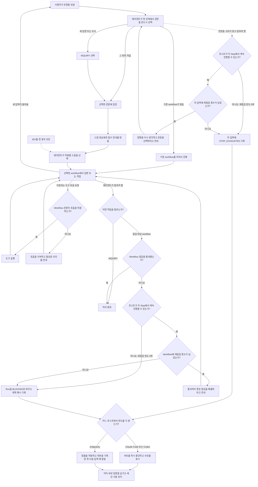
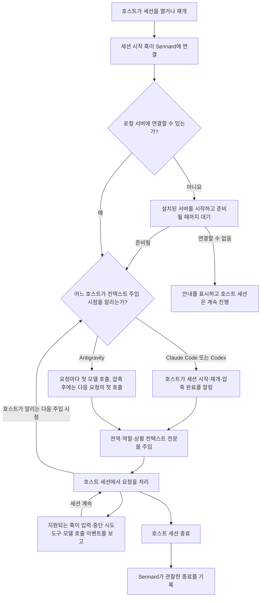
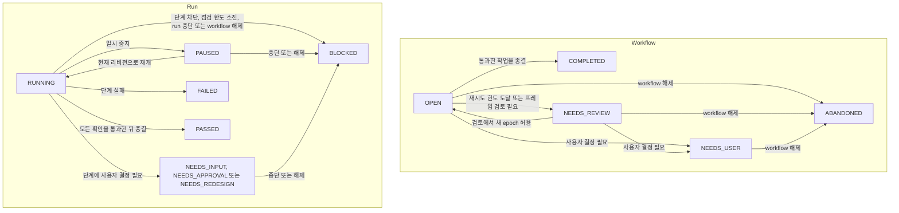
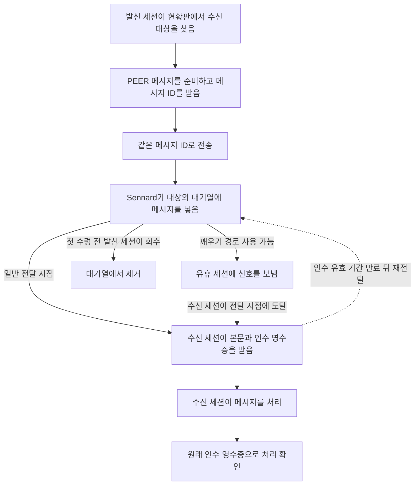

[English](system-flow.md)

# Sennard 전체 흐름도

이 문서는 Sennard 1.3.0의 요청 처리, 호스트 세션 수명, workflow 상태 전이, 세션 간 메시지 전달 과정을 보여 줍니다. 호스트 훅은 이벤트를 로컬 Sennard 서버에 전달합니다. 에이전트는 서버의 MCP 도구로 관문을 선택하고 작업을 기록합니다.

## 사용자 요청 처리

답변이나 조사에는 조사 관문(INQUIRY)을 선택합니다. 답변만 하는 요청도 여기에 해당합니다. 변경, 실행, 상태 전이는 각각 해당 관문을 선택합니다. 제품 파일을 편집하려면 해당 파일을 변경 계획에 넣은 CHANGE workflow가 필요합니다. 서버는 EXECUTION을 `OPERATION`으로 기록합니다. 절차별 진입 도구는 [사용하기](usage.ko.md#workflow-종류와-관문)를 참고하십시오.

관문 입장 응답에서 스킬 대상표와 접수 안내를 받습니다. JEV는 켠 경우에 조언을 제공하며, 최종 스킬은 에이전트가 선택합니다.

Sennard의 작업 단위는 workflow입니다. 새 입력이 들어오면 에이전트가 기존 workflow를 이어서 진행할지 새로 열지 판단합니다. 에이전트가 멈추려 할 때 호스트의 Stop 계열 훅이 점검을 실행합니다.

점검을 통과하지 못한 workflow의 재점검 횟수는 호스트가 계속 진행할 수 있는 Stop에서만 늘어납니다. 계속 진행할 수 있는 Stop에서는 관리자 페이지의 현재 epoch당 시도 횟수 설정을 재점검 한도로 적용합니다. 호스트가 이 Stop에서 계속 진행할 수 없으면 한도는 0회입니다. 재점검 횟수가 남지 않은 상태에서 점검을 통과하지 못하면 서버가 계획의 SHA-256 해시를 기록하고 해당 run을 `BLOCKED`로 바꿉니다. 이 run은 조회만 할 수 있습니다. 재개, 단계 결과 기록, 종결, 계획 수정은 거절됩니다. 한도를 다 쓰기 전에 에이전트가 `abort_workflow`로 닫으면, workflow가 점검을 한 번이라도 통과하지 못한 경우에만 계획 해시를 기록합니다. INQUIRY는 workflow 점검 집계에서 제외되므로 workflow 한도 소진, 점검에 따른 사용 불가 처리, 계획 해시 기록이 없습니다.

서버는 같은 작업 폴더에서 workflow 종류와 SHA-256 해시가 거절 대상 계획과 일치하면 세션이나 호스트가 달라도 등록이나 계획 제출을 거절합니다. 응답은 거절 사유와 처음 사용 불가가 된 workflow를 알려 줍니다. 거절 시 다른 workflow의 상태는 그대로입니다. 내용을 바꿔 해시가 달라진 계획은 제출할 수 있습니다. 해시 거절은 사용자가 관리자 페이지에서 해제할 수 있습니다. 에이전트는 해제할 수 없으며 자동으로 만료되지 않습니다.

에이전트가 관문을 고르지 않고 멈추려 할 때, 호스트가 계속 진행할 수 있는 Stop이고 재점검 횟수가 남아 있으면 입력별 횟수를 한 번 늘립니다. 이때 훅은 방향을 다시 생각하고 관문을 고르라고 안내합니다. 호스트가 Stop에서 계속 진행할 수 없으면 서버는 재점검 한도를 0회로 적용합니다. 한도에 도달하면 서버는 해당 입력에 `STOP_EXHAUSTED`를 기록하고 턴이 끝납니다. 이 점검에서 workflow를 `BLOCKED`로 바꾸는 기준은 그 workflow의 재점검 한도입니다.

어느 한도든 다 쓰면 Claude Code와 Codex는 처리를 즉시 중단하고 사유를 표시합니다. Antigravity는 그 자리에서 위반을 표시하지 않고 에이전트가 멈추도록 허용합니다. 서버는 위반을 기록하고, workflow 한도였다면 해당 run을 `BLOCKED`로 바꿉니다. 알림은 다음 입력이 들어올 때 표시합니다. 이미 보낸 답변은 남고 세션은 다음 요청을 받을 수 있습니다.

## 세션 수명

Claude Code와 Codex는 호스트의 공식 세션 시작·재개·압축 후 신호를 사용합니다. Antigravity는 요청마다 첫 모델 호출(`invocationNum=0`)에 한 번 주입합니다. Antigravity 요청 도중 자동 압축이 일어나면 다음 요청의 첫 모델 호출에서 복원합니다.

재개나 압축 뒤에 이어갈 작업은 `checkpoint_context`로 저장합니다. Sennard는 세션 종료 훅이나 감시 중인 호스트 프로세스의 종료를 통해 세션이 끝났음을 기록할 수 있습니다. 로컬 서버는 다른 세션을 위해 계속 실행됩니다.

## Workflow와 Run의 상태 전이

Workflow는 여러 시도에 걸쳐 작업 상태를 관리합니다. 한 번의 시도를 run이라고 합니다. CHANGE run은 계획 단계에서 시작해 변경할 파일 목록을 제출한 뒤 실행 단계로 넘어갈 수 있습니다. 단계 결과에 따라 run이 다음 단계로 진행하거나 시도를 멈추고, workflow가 사용자 결정을 요구하는 상태로 바뀔 수 있습니다.

일시 중지는 현재 run과 작업 범위를 유지합니다. 중단은 해당 run을 끝내며, 새 시도를 위해 workflow가 열린 상태로 남을 수 있습니다. Workflow가 열려 있고 재시도 조건을 충족하면 새 run을 확보해 시작합니다. 성공적으로 종결하거나 workflow를 해제하면 작업 범위가 풀립니다. 진행 상황을 기록하고 run을 마치는 방법은 [사용하기](usage.ko.md)를 참고하십시오.

## 세션 간 협업

같은 OS 사용자의 세션은 로컬 서버를 함께 사용합니다. 발신 세션은 현황판에서 수신 대상을 조회합니다. 대기열의 메시지 본문은 호스트가 지원하는 시점에 전달되며, 유휴 세션을 깨울 수 있는지는 호스트와 연결 상태에 따라 달라집니다. 전송 결과가 불확실하면 기존 메시지 ID로 상태를 확인합니다. ACK는 메시지 처리를 확인합니다. 회신이나 작업 결과는 별도 메시지로 전합니다. 도구 이름과 상태 확인 방법, 호스트별 깨우기 동작은 [세션 협업](collaboration.ko.md)을 참고하십시오.
