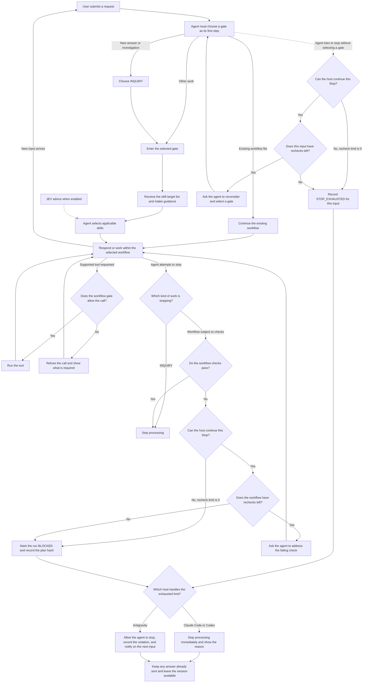
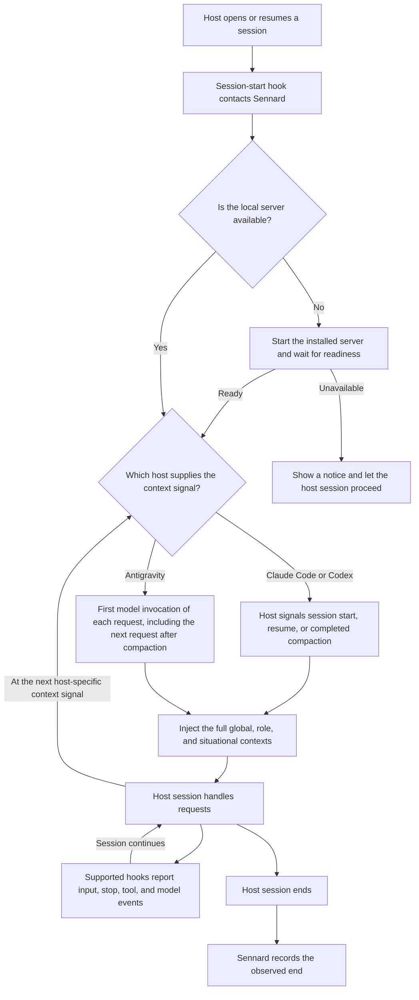
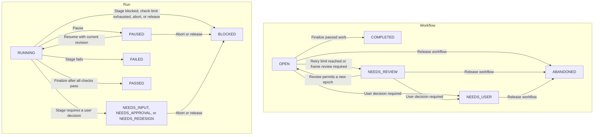
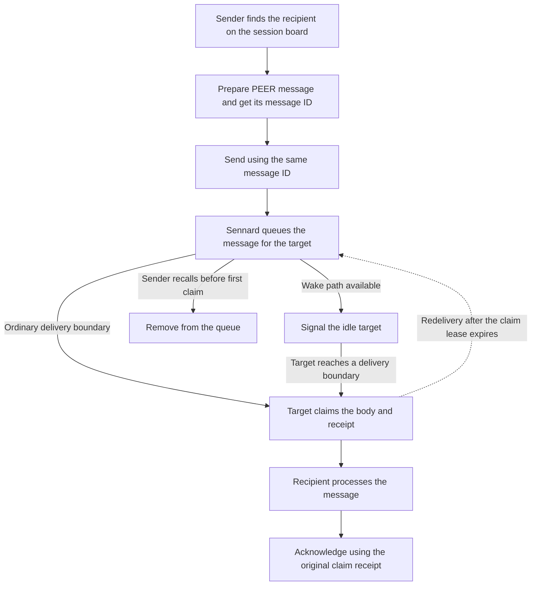

[한국어](system-flow.ko.md)

# Sennard System Flow

These diagrams show how Sennard 1.3.0 handles requests, observes host sessions, tracks workflows, and delivers messages between sessions. Host hooks report events to the local Sennard server. The agent uses the server's MCP tools to choose a gate and record work.

## Handling a User Request

Choose INQUIRY for an answer or an investigation, including a request that only needs an answer. Gates for changes, execution, and lifecycle transitions serve their respective kinds of work. Product-file edits require a CHANGE workflow with those files in its change plan. The server stores EXECUTION as `OPERATION`. See [Usage](usage.md#workflow-kinds-and-the-workflow-gate) for the entry point of each procedure.

The gate-entry response provides the skill target list and intake guidance. JEV adds optional advice when enabled. The agent makes the final skill selection.

The workflow is Sennard's unit of work. When new input arrives, the agent decides whether to continue an existing workflow or open a new one. A host's Stop hook or equivalent triggers the checks when the agent attempts to stop.

A failing workflow uses a recheck only at a Stop the host can continue. At a continuable Stop, the current attempts-per-epoch setting on the admin page sets the recheck limit. If the host cannot continue the Stop, the limit is zero. When a check fails with no rechecks left, the server records the plan's SHA-256 hash and marks the run `BLOCKED`. The run is available for inspection only. Attempts to resume it, record a stage result, finalize it, or edit its plan are refused. If the agent calls `abort_workflow` before the limit is exhausted, the server records the hash only if the workflow has already failed a check. INQUIRY is outside the workflow check count and does not exhaust a workflow limit, become unavailable through a check, or have a plan hash recorded.

When the working folder, workflow kind, and SHA-256 hash match a blocked plan, the server refuses registration or plan submission across sessions and hosts. The response gives the reason and identifies the workflow that originally became unavailable. Refusal leaves other workflows in their current states. A changed plan with a different hash can be submitted. The user can lift a hash block on the admin page. The agent cannot lift it, and the block does not expire automatically.

If the agent tries to stop without selecting a gate, the input's recheck count increases only at a Stop the host can continue and while a recheck remains. The hook then asks the agent to reconsider and select a gate. If the host cannot continue the Stop, the server applies a recheck limit of zero. The server records `STOP_EXHAUSTED` for the input when the limit is reached, and the turn ends. The workflow's own recheck limit determines when these checks mark it `BLOCKED`.

At either limit, Claude Code and Codex stop processing immediately and show the reason. Antigravity allows the agent to stop without showing the violation at that point. The server records the violation and, for a workflow limit, the `BLOCKED` run. It shows the notice when the next input arrives. Any answer already sent remains visible, and the session can accept another request.

## Session Lifecycle

Claude Code and Codex use the host's official session-start, resume, and post-compaction signals. Antigravity injects context once per request, at the first model invocation (`invocationNum=0`). After automatic compaction during an Antigravity request, context is restored at the first model invocation of the next request.

Use `checkpoint_context` to save work that needs to survive a resume or compaction. Sennard can record a session end from an end hook or from the exit of a monitored host process. The local server continues to serve other sessions.

## Workflow and Run States

A workflow tracks the work across attempts. Each attempt is a run. A CHANGE run can start in planning and enter execution once its file plan is submitted. Stage results can advance the run, stop the attempt, or put the workflow in a state that requires a user decision.

Pausing preserves the current run and its scope. Aborting ends the run and can leave the workflow open for another attempt. If the workflow stays open and the retry requirements are met, claim and start a new run. Successful finalization and release both free the workflow's scope. See [Usage](usage.md#workflows-and-the-edit-gate) for how to record progress and finish a run.

## Collaboration Between Sessions

Sessions under the same OS user share the local server. The session board is how a sender looks up a target. The message queue delivers the body at a supported host boundary, and wake support depends on the host and its live connection. If the send result is uncertain, check the existing message ID. An acknowledgment confirms processing. Replies or work results travel as separate messages. See [Session Collaboration](collaboration.md) for tool names, status checks, and host-specific wake behavior.
